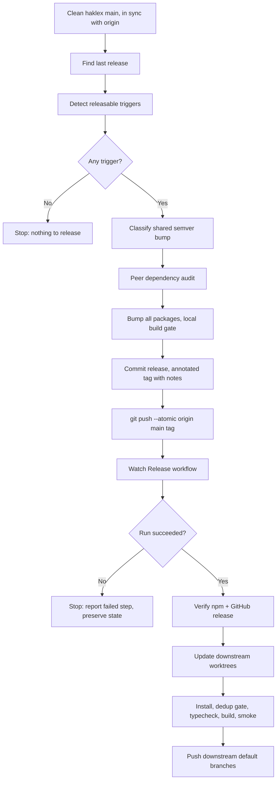

# Release Orchestrator

End-to-end release procedure for the shared-version `@haklex/*` package family. GitHub Actions publishes; this skill prepares the release, pushes the tag, watches the `Release` workflow, and only then propagates the version downstream.

## Operating Contract

| Rule                | Requirement                                                                                                                                                      |
| ------------------- | ---------------------------------------------------------------------------------------------------------------------------------------------------------------- |
| Autonomy            | Infer release metadata from repository state. Do not ask for package lists, semver level, downstream branch, or confirmation unless a stop condition is reached. |
| Versioning          | All `@haklex/*` packages share one version, read from `packages/rich-editor/package.json`.                                                                       |
| Always full         | Every release publishes every public `@haklex/*` package. There is no incremental mode and no publish-set computation.                                           |
| CI publishes        | npm publish happens only in `.github/workflows/release.yml` (trusted publishing, OIDC). Never run `npm publish` / `pnpm publish` locally.                        |
| Downstream waits    | Downstream propagation starts only after the `Release` run for the tag concludes `success`.                                                                      |
| Peer safety         | Treat duplicate runtime copies of `lexical`, React, `lucide-react`, `shiki`, and `@lexical/*` as release-blocking defects.                                       |
| Downstream          | Update downstream default branches directly after validation. Do not open PRs unless direct push is blocked and the user confirms the fallback.                  |
| Destructive actions | Do not discard, reset, restore, force-remove, or silently overwrite user-owned changes. Preserve state and ask before destructive recovery.                      |

## Required Reading Order

| Stage                                                               | Reference                                                                                |
| ------------------------------------------------------------------- | ---------------------------------------------------------------------------------------- |
| Repository and downstream layout                                    | [references/repo-layout.md](references/repo-layout.md)                                   |
| Change detection, semver, peer audit                                | [references/release-analysis.md](references/release-analysis.md)                         |
| Bump, local gate, tag push, CI watch                                | [references/publish-pipeline.md](references/publish-pipeline.md)                         |
| Downstream propagation, third-party pin reconciliation, smoke tests | [references/downstream-propagation.md](references/downstream-propagation.md)             |
| Stop conditions, safe recovery, common mistakes, real-world anchors | [references/failure-recovery-and-anchors.md](references/failure-recovery-and-anchors.md) |

## Execution Flow

## What CI Does (`.github/workflows/release.yml`)

Triggered by any `v*` tag push:

1. `scripts/release/publish.mjs check $TAG`: every public package is on the shared version and the tag equals it.
2. `pnpm install --frozen-lockfile`, `pnpm typecheck`, `pnpm test`, `pnpm run build:packages`.
3. `scripts/release/publish.mjs publish`: leaf-first, `pnpm pack` each package, `npm publish <tarball>` via OIDC. Already-published versions are skipped, so a re-run resumes a partial publish.
4. `scripts/release/publish.mjs wait 90`: polls until every package resolves on npm.
5. `@haklex/rich-litexml-cli` binary smoke.
6. `gh release create` with the annotated tag's body as notes (falls back to `--generate-notes`).

## Helper Scripts

| Script                                                                           | Purpose                                                                                                                                       |
| -------------------------------------------------------------------------------- | --------------------------------------------------------------------------------------------------------------------------------------------- |
| [scripts/release-context.sh](scripts/release-context.sh)                         | Derive `LAST`, local version, source changes, and peer-drift triggers.                                                                        |
| [scripts/peer-audit.sh](scripts/peer-audit.sh)                                   | Detect always-peer libraries under `dependencies`, internal `@haklex/*` peer pins using `workspace:*`, and divergent third-party peer floors. |
| [scripts/watch-release.sh](scripts/watch-release.sh)                             | Find the `Release` run for a tag, stream it to completion, then verify npm and the GitHub release.                                            |
| [scripts/registry-peer-floors.sh](scripts/registry-peer-floors.sh)               | Aggregate non-`@haklex/*` peer floors from published registry manifests.                                                                      |
| [scripts/downstream-dispatch.sh](scripts/downstream-dispatch.sh)                 | Emit downstream manifest rewrite rows for `@haklex/*` pins and third-party peer-floor reconciliation.                                         |
| [scripts/duplicate-runtime-invariant.sh](scripts/duplicate-runtime-invariant.sh) | Assert a single resolved version for runtime-anchored libraries in a downstream worktree.                                                     |
| `scripts/release/publish.mjs` (repo root)                                        | `check` / `list` / `publish` / `wait`; `list` prints every public package leaf-first and is the package set for downstream rewrites.          |
| `scripts/release/trust-setup.sh` (repo root)                                     | One-time, interactive: register the workflow as npm trusted publisher for every package. Rerun after adding a package (see Stop Conditions).  |

## Phase Index

| Phase | Action                                                        | Primary Reference                                                             |
| ----- | ------------------------------------------------------------- | ----------------------------------------------------------------------------- |
| 1     | Pre-flight and releasable trigger detection                   | [release-analysis.md](references/release-analysis.md)                         |
| 2     | Shared semver classification                                  | [release-analysis.md](references/release-analysis.md)                         |
| 3     | Peer dependency audit                                         | [release-analysis.md](references/release-analysis.md)                         |
| 4     | Bump, local build gate, release commit, annotated tag         | [publish-pipeline.md](references/publish-pipeline.md)                         |
| 5     | Atomic push, watch CI, verify npm and GitHub release          | [publish-pipeline.md](references/publish-pipeline.md)                         |
| 6     | Downstream worktrees, pin rewrites, peer-floor reconciliation | [downstream-propagation.md](references/downstream-propagation.md)             |
| 7     | Downstream smoke tests and duplicate-runtime invariant        | [downstream-propagation.md](references/downstream-propagation.md)             |
| 8     | Failure handling or direct downstream push                    | [failure-recovery-and-anchors.md](references/failure-recovery-and-anchors.md) |
| 9     | Final summary                                                 | [failure-recovery-and-anchors.md](references/failure-recovery-and-anchors.md) |

## Non-Negotiable Checks

| Check                  | Command / Script                                                                       |
| ---------------------- | -------------------------------------------------------------------------------------- |
| Last release SHA       | `git log --grep='^release: v' -n1 --format=%H`                                         |
| Context detection      | `./.claude/skills/release-orchestrator/scripts/release-context.sh`                     |
| Peer audit             | `./.claude/skills/release-orchestrator/scripts/peer-audit.sh "$LAST"`                  |
| Bump                   | `pnpm bumpp -r "$LEVEL" --no-git --no-tag --yes`                                       |
| Local gate             | `node scripts/release/publish.mjs check "v$NEW_VERSION"` and `pnpm run build:packages` |
| Tag                    | `git tag -a "v$NEW_VERSION" --cleanup=verbatim -F "$TAG_MSG"`                          |
| Push                   | `git push --atomic origin main "v$NEW_VERSION"`                                        |
| Watch CI               | `./.claude/skills/release-orchestrator/scripts/watch-release.sh "v$NEW_VERSION"`       |
| Duplicate-runtime gate | `./.claude/skills/release-orchestrator/scripts/duplicate-runtime-invariant.sh`         |

## Stop Conditions

- Haklex worktree is dirty, not on `main`, or `main` differs from `origin/main` before release mutation.
- No `src/**` change and no non-`@haklex/*` peer-range advance since `$LAST`.
- A package in `publish.mjs list` does not exist on npm yet: trusted publishing cannot create a package. Ask the user to publish its first version by hand and run `scripts/release/trust-setup.sh`, then continue.
- `gh` is missing or unauthenticated.
- Phase 3 detects internal `@haklex/*` `peerDependencies` using `workspace:*`, or divergent third-party peer floors.
- The `Release` run for the tag fails or is cancelled.
- Downstream default branch cannot be derived from `origin/HEAD`.
- Downstream rebase conflicts or direct push is rejected.
- Duplicate-runtime invariant reports more than one resolved version for any runtime-anchored library.
- Any recovery path would discard, overwrite, reset, restore, or force-delete user-owned changes.
