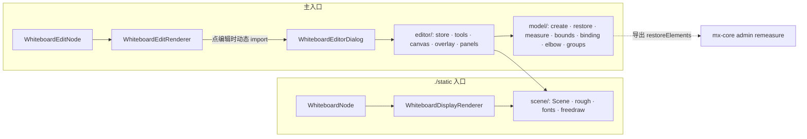

# 自研白板编辑器：替换 @excalidraw/excalidraw

这是要拿去实现的设计稿，已于 2026-11-11 批准。

## 1. 意图

把 `@haklex/rich-ext-excalidraw` 改名为 `@haklex/rich-ext-whiteboard`，并把它编辑弹窗里懒加载的 Excalidraw 换成自研编辑器。编辑器读写同一份 Excalidraw 场景 JSON（`elements` / `appState` / `files`），存量文章不迁移。完成后 haklex、demo、mx-core admin、Yohaku 里都不再有 `@excalidraw/excalidraw`。

动机（我的理解，你没有另外说明）：Excalidraw 安装体积约 48 MB，编辑器 chunk 很大；为了它在 `pnpm-workspace.yaml` 里提升了 react；它的 UI 和 Quiet Ink 不搭；编辑时和展示时用两套渲染，样子有出入。

现状：只读展示已经是自研的。`scene/Scene.tsx` 用 roughjs 把场景画成 SVG，`scene/InteractiveScene.tsx` 负责平移缩放。只有 `ExcalidrawEditRenderer` → `ExcalidrawEditorDialog` 这条编辑路径，以及 mx-core admin 的 `excalidraw-remeasure.ts`（调用 `restoreElements` 重算文字尺寸）依赖 Excalidraw。

## 2. 目标、非目标、反目标

| 类别   | 内容                                                                                                                                           |
| ------ | ---------------------------------------------------------------------------------------------------------------------------------------------- |
| 目标   | 完整档编辑能力（见第 5 节）；编辑和展示同像素；旧数据打开、不改、保存后不丢任何字段；触屏基本可用；删掉所有 Excalidraw 依赖。                  |
| 非目标 | 协作、素材库、Mermaid 转白板、AI 生成、导出 PNG/SVG、embeddable/iframe 编辑（只保留占位显示和移动）、激光笔、演示模式。                        |
| 反目标 | 不能让旧白板除字体、笔迹、frame 裁剪、图片裁剪以外的样子改变；不能在保存时丢掉编辑器不认识的字段或元素；不能把编辑器代码带进 `./static` 入口。 |

## 3. 约束

- 数据格式：Excalidraw 场景 JSON v2。新建元素按 Excalidraw 的字段齐全写出（`id`、`seed`、`version`、`versionNonce`、`index`、`updated`、`groupIds`、`frameId`、`boundElements`、`link`、`locked` 等），这样 JSON 拿到 excalidraw.com 仍能打开。
- 静态 / 编辑拆分：`./static` 只含 Node、展示渲染器和 `scene/`，不能引入 `@haklex/rich-editor-ui`、`lucide-react` 或 `editor/` 下任何文件。编辑器整体在点「编辑」时动态 import，和现在一样。
- 仓库规范：Vanilla Extract 样式；`use(Context)` 而不是 `useContext`；Context value 用 `useMemo`；单文件不超过 500 行，组件不超过 300 行；默认不写注释；中性灰用 `#737373` / `#a3a3a3`。
- 新增运行时依赖只允许 `perfect-freehand`（已定），加上现有的 `roughjs`、`jsondiffpatch`。

## 4. 已定

- 数据格式保持 Excalidraw 场景 JSON，旧数据不迁移。（你定的）
- haklex 里删掉 `@excalidraw/excalidraw`。（你定的）
- 第一版做完整档：基本图形、样式面板、多选、复制粘贴、旋转、图层，加箭头吸附、容器内文字、编组、图片、frame、折线点编辑。（你定的）
- 编辑时用 SVG，复用 `Scene` 的元素组件。（你定的）
- 包改名为 `@haklex/rich-ext-whiteboard`，同一个版本切换，旧包在 npm 上标 deprecated、不再发布。（你定的）
- Lexical type `excalidraw` 和 LiteXML 标签 `<excalidraw>` 保留，只改类名和导出名。（你定的，批准时再次确认）
- 触屏基本可用：单指画和拖，双指平移缩放，窄屏工具栏。（你定的）
- 默认手绘风格（roughness 1、hachure 填充）；手写体编号 1 和 5 统一用霞鹜文楷渲染，展示和编辑都一样，旧白板的文字也随之变成文楷。（你定的）
- 图片：配置里加 `uploadFile(file) => Promise<string>`，有就上传并把 URL 写进 `files[id].dataURL`，没有就退回 base64。（你定的）
- 折线箭头做自动寻路，绕开路径上的图形。（你定的）
- 自由画笔改用 perfect-freehand 按 `pressures` 画，展示和编辑都一样。（你定的）
- 在分支上分阶段开发，旧编辑器留到完整档做完，一次切换并删依赖。（你定的）
- 快照的三种存储方式（inline / remote / delta）、保存流程、导出与复制 JSON 都不变。（我的决定）
- 编辑器不认识的字段和元素原样保留。（我的决定）
- 失败标准：除字体、笔迹、frame 裁剪和图片裁剪以外旧白板样子变了，或保存后丢字段。两条都写成验收测试。后两项是展示端补上 Excalidraw 本来就有的效果，旧白板会更接近作者当初在 Excalidraw 里看到的样子。（我的决定，你没填）
- 快捷键沿用 Excalidraw：V 选择、H 抓手、R 矩形、D 菱形、O 椭圆、A 箭头、L 直线、P 画笔、T 文字、I 图片、F frame、E 橡皮；Ctrl+Z / Ctrl+Shift+Z / Ctrl+G / Ctrl+Shift+G / Ctrl+D / Ctrl+A / Delete / 方向键（Shift 加大步长）/ Ctrl+] [ 调层级。（我的决定）
- 字体文件不打进包，由 `fontCssHref` 指向的样式表加载。现在 Yohaku 和 mx-core admin 都没配置它。（我的决定）
- frame 裁剪和图片 `crop` 在第 2 阶段同时加进 `Scene`，展示和编辑一致。（我的决定）
- 保存格式：`appState` 保留载入时的原对象，只覆盖 `viewBackgroundColor` 和 `gridSize`；场景顶层不认识的键原样带回。元素数组载入时不做补齐，原对象直接进 store，只有被修改的元素才补齐缺失字段。`isDeleted` 元素只在编辑期间存在（供撤销），保存时剔除，和现在 `getSceneElements()` 的行为一致。（我的决定）
- `restoreElements` 导出为异步：先 `document.fonts.load` 用到的字体再测量。admin 的 `remeasureScene` 本来就是 async，改成 await 即可。（我的决定）
- 编辑器 chunk 体积是目标值，不是硬门槛：80 KB gzip 只算本包代码和 `perfect-freehand`，不算 `roughjs`、`@haklex/rich-editor-ui`、`lucide-react`（宿主本来就有）。超出时报出来，不为它拆功能。（我的决定）
- 霞鹜文楷默认从 jsDelivr 的 `lxgw-wenkai-screen-webfont` 样式表加载（`fontCssHref` 的默认值），宿主可以覆盖。（你批准的推荐）
- rich-compose 模块跟着改名：`modules/excalidraw` → `modules/whiteboard`，CSS 产物 `style/whiteboard.css`；RendererConfig 的槽位 `Excalidraw` → `Whiteboard`。（我的决定，跟着同版本切换走）

## 5. 编辑能力

| 领域     | 行为                                                                                                                                                                                                                                                                                                                                                                            |
| -------- | ------------------------------------------------------------------------------------------------------------------------------------------------------------------------------------------------------------------------------------------------------------------------------------------------------------------------------------------------------------------------------- |
| 工具     | 选择、抓手、矩形、菱形、椭圆、箭头、直线、画笔、文字、图片、frame、橡皮。工具栏上有「锁定工具」开关：关闭时画完一个回到选择。                                                                                                                                                                                                                                                   |
| 选择     | 点选、Shift 加选、框选（完全包住才选中）、Ctrl+A；点到编组里的元素先选中整组，双击进入组内。锁定元素不能被点选或框选。                                                                                                                                                                                                                                                          |
| 变换     | 拖动移动；8 个控制点缩放（Shift 等比，Alt 以中心缩放）；旋转手柄（Shift 吸附 15°）；多选时整体缩放和旋转。方向键微调 1px，Shift 10px。                                                                                                                                                                                                                                          |
| 样式面板 | 描边色、背景色（含透明）、填充样式（hachure / cross-hatch / solid）、线宽三档、线型（实线 / 虚线 / 点线）、粗糙度三档（0 / 1 / 2）、圆角（直角 / 圆角）、透明度、字号四档、字体（手写 / 无衬线 / 等宽）、文字对齐、箭头端点样式、箭头类型（直线 / 曲线 / 折线）、图层顺序、编组和解组、删除、复制一份。选中多个时显示共同值，不同则显示为混合。新画的元素沿用上一次改过的样式。 |
| 文字     | 文字工具点击处新建；双击文字编辑；双击矩形 / 菱形 / 椭圆在容器里加文字（`containerId` 和容器的 `boundElements` 双向写入），容器缩放时文字重新换行、居中；双击箭头在箭头中点加标签。编辑用覆盖在 SVG 上的 textarea，字体、字号、行高与渲染一致；用 canvas `measureText` 测量写回 `width` / `height`。                                                                            |
| 线条     | 箭头和直线：拖拽画两点；点击逐点画多段，回车或 Esc 结束；选中后显示每个点，可拖动、双击加点、选中点 Delete 删除；曲线类型的渲染与现有 `curve` 一致。                                                                                                                                                                                                                            |
| 吸附     | 箭头端点落在图形边界附近时吸附，写 `startBinding` / `endBinding`（`elementId`、`focus`、`gap`）并在图形的 `boundElements` 里登记；图形移动、缩放、旋转后，绑定的箭头端点按 focus 和 gap 重新计算。删除图形时解除绑定。按住 Ctrl 拖动端点不吸附。                                                                                                                                |
| 折线箭头 | `elbowed: true`。端点间做正交路径的自动寻路：在相关图形的扩展包围盒构成的稀疏网格上跑 A*，代价含转弯惩罚，绕开路径上的其他图形。端点绑定图形时，从图形朝向箭头的那一边出发。图形移动时重算路径。用户拖过的中段写进 `fixedSegments` 并保留。                                                                                                                                     |
| 编组     | Ctrl+G 生成新 group id 追加到每个元素 `groupIds` 末尾，Ctrl+Shift+G 去掉最外层；支持嵌套。                                                                                                                                                                                                                                                                                      |
| 图片     | 图片工具选文件、拖入、粘贴图片都能插入。插入时保持原比例、最长边不超过 600 px；`files[fileId]` 写 `mimeType`、`created`、`dataURL`（上传成功是 URL，否则 base64）。上传过程中元素 `status: 'pending'`，显示占位；失败时退回 base64 并 toast 提示。不做裁剪编辑，已有的 `crop` 原样保留并照常渲染。                                                                              |
| frame    | 画 frame；frame 完全包住的元素在松手时写入 `frameId`；移动 frame 带着子元素一起走；子元素拖出 frame 时清掉 `frameId`；frame 内的元素按 frame 边界裁剪显示；双击 frame 标题改名。                                                                                                                                                                                                |
| 橡皮     | 按住划过的元素变半透明，松手删除（写 `isDeleted: true`，和 Excalidraw 一样保留在数组里）。                                                                                                                                                                                                                                                                                      |
| 历史     | 每次提交的操作（一次拖动、一次样式改动、一次文字编辑结束）是一条历史；只记录元素和文件变更，视口和选中状态不入历史；上限 100 条。                                                                                                                                                                                                                                               |
| 剪贴板   | 复制写入 Excalidraw 的剪贴板格式（`{"type":"excalidraw/clipboard","elements":[…],"files":{…}}`），所以能和 excalidraw.com 互相粘贴；粘贴到鼠标位置，重新生成 id 并保持组和绑定关系；粘贴纯文本生成文字元素。                                                                                                                                                                    |
| 视口     | 滚轮平移，Ctrl / 触控板捏合缩放（以指针为中心，0.1×–30×），空格加拖动或抓手工具平移，Shift+1 适配全部内容，Ctrl+0 重置 100%。可选网格（`appState.gridSize`，开启时移动和缩放吸附到网格）。                                                                                                                                                                                      |
| 触屏     | 单指按当前工具操作；双指平移加缩放，并取消正在进行的单指操作；Apple Pencil 用 `pressure` 记压感；窄屏（宽度小于 640px）时工具栏移到底部，样式面板改成底部抽屉。                                                                                                                                                                                                                 |

## 5.1 界面

界面在 artboard 上分两轮定下，下面每条都链接到选中的那张图。

方向（我的判断）：作者在文章编辑器里画讲解图，桌面为主、偶尔 iPad；气质安静、像墨水、带手作感；纸和墨的世界，中性灰加一支蓝笔 `#2563eb`；标志是点阵纸底纹。所有颜色、字号、圆角都取自 `@haklex/rich-style-token`。

- 工具放进 ModalShell 标题栏中间的槽位；样式面板只在有选中时浮在画布右上角（宽 232px）；撤销、重做和缩放浮在画布左下角：artboard `haklex-whiteboard-editor-ui` board haklex-whiteboard-editor-ui。（你选的，同推荐）
- 画布底纹用 16px 点阵纸，延续现有占位图：artboard `haklex-whiteboard-editor-ui` board haklex-whiteboard-editor-ui。（你选的，同推荐）
- 选中元素：1px 实线 accent 框、白底圆形控制点、上方一个圆形旋转手柄；触控热区放大到 24px：artboard `haklex-whiteboard-editor-ui` board haklex-whiteboard-editor-ui。（你选的，同推荐）
- 宽度小于 640px：标题栏只留标题和关闭；工具改成画布底部的浮动条（可横向滚动）；有选中时样式面板从工具条上方弹出，只放常用 4 行，其余收进「更多样式与操作」。iPad 竖屏（834px）仍用桌面布局：artboard `haklex-whiteboard-editor-ui` board haklex-whiteboard-editor-ui。（你选的，同推荐）
- 样式面板只列和选中元素类型相关的属性；多选不同类型时取它们共有的属性：artboard `haklex-whiteboard-editor-ui` board haklex-whiteboard-editor-ui。（你选的，同推荐）
- 深色模式：编辑器外壳用 token 的深色值，画布沿用展示端的 `DARK_SCENE_FILTER` 反色，所以编辑和展示在深色下也一致。（我的决定）

## 6. 架构

### 6.1 目录

| 路径                             | 内容                                                                                                                                                                                                                                                                                                                                               |
| -------------------------------- | -------------------------------------------------------------------------------------------------------------------------------------------------------------------------------------------------------------------------------------------------------------------------------------------------------------------------------------------------- |
| `src/scene/`                     | 现有的静态渲染。改动：`fonts.ts` 手写体栈改成文楷在前；新增 `freedraw.ts` 用 perfect-freehand 生成笔迹轮廓；`SceneContent` 增加可选的 `elementProps` 回调，让编辑器给元素挂 `data-id`、隐藏正在编辑的文字。                                                                                                                                        |
| `src/model/`                     | 纯函数，不依赖 React：`create.ts`（带默认值和随机 seed 的元素工厂）、`restore.ts`（补齐缺失字段、可选重算文字尺寸、修正容器文字位置）、`measure.ts`、`bounds.ts`（旋转后的包围盒和命中测试）、`binding.ts`、`elbow.ts`、`groups.ts`、`frames.ts`、`fractional-index.ts`、`clipboard.ts`。                                                          |
| `src/editor/`                    | React：`store.ts`（`useSyncExternalStore` 订阅的单一 store：元素、文件、视口、选中、当前工具、当前样式、历史）、`tools/`（每个工具一个指针事件处理器）、`WhiteboardCanvas.tsx`（SVG 视口加 `SceneContent`）、`overlay/`（选框、控制点、旋转手柄、线条点、吸附高亮、框选矩形）、`TextEditor.tsx`、`Toolbar.tsx`、`StylePanel.tsx`、`shortcuts.ts`。 |
| `src/WhiteboardEditorDialog.tsx` | 由现在的 `ExcalidrawEditorDialog` 改来：`ExcalidrawComponent` 换成 `WhiteboardEditor`，`apiRef` 换成 store 句柄（`getScene()`、`ownsEscape()`、`subscribe()`）。`canvas-state.ts` 改用自己的状态判断 Esc 归属和脏标记。                                                                                                                            |

### 6.2 改名对照

| 旧                                                                  | 新                                                                                                             |
| ------------------------------------------------------------------- | -------------------------------------------------------------------------------------------------------------- |
| `@haklex/rich-ext-excalidraw`                                       | `@haklex/rich-ext-whiteboard`                                                                                  |
| `ExcalidrawNode` / `ExcalidrawEditNode` / `$createExcalidrawNode` … | `WhiteboardNode` / `WhiteboardEditNode` / `$createWhiteboardNode` …（`getType()` 仍返回 `'excalidraw'`）       |
| `ExcalidrawConfigProvider`（apiUrl、fontCssHref、saveSnapshot）     | `WhiteboardConfigProvider`，新增 `uploadFile`                                                                  |
| `INSERT_EXCALIDRAW_COMMAND`、`ExcalidrawPlugin`                     | `INSERT_WHITEBOARD_COMMAND`、`WhiteboardPlugin`                                                                |
| RendererConfig 槽位 `Excalidraw`、`EXCALIDRAW_NODE_KEY`             | `Whiteboard`、`WHITEBOARD_NODE_KEY`                                                                            |
| `ExcalidrawSnapshot`、`parseSnapshot`、`serializeSnapshot`          | `WhiteboardSnapshot`，函数名不变                                                                               |
| （无）                                                              | 新导出 `restoreElements(elements, null, { refreshDimensions })`，参数兼容 mx-core admin 现有调用，返回 Promise |
| `EXCALIDRAW_BLOCK_TRANSFORMER`                                      | 不变：它来自 `@haklex/rich-headless`，节点类型没变                                                             |

旧的 `ExcalidrawStaticRenderer` / `ExcalidrawRenderer` 兼容别名直接删除。

## 7. 字体

手写体（编号 1 Virgil、5 Excalifont）的渲染栈改为 `"LXGW WenKai Screen", "LXGW WenKai", "Excalifont", "Virgil", cursive`；编号 2 / 6 / 9 走无衬线栈，3 / 8 走等宽栈（现在除 3 以外都落到手写体，顺带修正）。新文字默认写 `fontFamily: 5`。

旧文字的 `width` / `height` 是按 Excalifont 量的，文楷字宽不同。打开时不重算，以免一打开就产生改动；只有被编辑的文字、或所在容器被缩放时才重算。渲染文字不裁剪，所以不会被截断，只是可能比旧包围盒略宽或略窄。

## 8. 下游与发布

1. **haklex 仓库内**：目录和包名改名；rich-compose 的 `modules/whiteboard`、`package.json` exports、`scripts/build-css.ts` 的 `MODULE_TO_PACKAGE`；`rich-litexml/src/readers/custom.ts` 里的包名；demo 的依赖、`vite.config.ts` 里的 `@excalidraw/excalidraw` 条目、页面和 fixtures；`pnpm-workspace.yaml` 删掉为 tunnel-rat 加的 react / react-dom 提升（删除后确认 `litexml-html-preview-client` 仍能构建）；README、`.claude/skills/litexml-authoring` 文档、`scripts/history/package-aliases.json`。

1. **首次发布新包**：按 release-orchestrator：新包需要手动首发，再跑 `scripts/release/trust-setup.sh`，之后才能走 CI 发布。旧包执行 `npm deprecate @haklex/rich-ext-excalidraw "renamed to @haklex/rich-ext-whiteboard"`。

1. **mx-core admin**：改 import（`RichEditor.tsx`、`RichRenderer.tsx`、`style.ts`、`RichEditorBridge.tsx`、`ReactEditorPane.tsx`、`mount-rich-diff.tsx` 及测试里的 mock）；`vite.config.mts` 的包名；`excalidraw-remeasure.ts` 改用新包的 `restoreElements`；配置里接上 `uploadFile`（复用 `~/api/files` 的 `uploadFile`）；删掉 `@excalidraw/excalidraw` 依赖。

1. **Yohaku**：改 import 和 `style.css` 路径，RendererConfig 槽位 `Excalidraw` → `Whiteboard`；确认 `fontCssHref` 指向的 CSS 含霞鹜文楷。

## 9. 分阶段（同一分支）

1. **改名**：包、类、导出、rich-compose 模块全部改名，编辑弹窗仍用 Excalidraw。现有测试全部通过。
2. **model 层**：create / restore / measure / bounds / fractional-index，加往返测试夹具。
3. **编辑器核心**：store、历史、视口、选择与变换、基本图形 / 线条 / 画笔 / 文字、样式面板、剪贴板、快捷键、触屏。
4. **完整档**：吸附、容器文字、箭头标签、折线寻路、编组、图片和上传、frame、橡皮。
5. **切换**：弹窗换成自研编辑器，删掉 Excalidraw 依赖和类型引用，perfect-freehand 和字体改动生效，更新下游并发布。

## 10. 验收

- **往返不丢字段**：从 demo fixtures 和 mx-core 线上数据抽 10 个以上真实场景（含绑定箭头、折线箭头、容器文字、编组、图片、frame、embeddable），载入编辑器后不做改动直接取场景，和原 JSON 去掉 `isDeleted` 元素后深比较必须相等。
- **旧白板样子不变（字体和笔迹除外）**：同一批场景，切换前后用 `Scene` 渲染出的 SVG 做快照对比；差异只允许出现在 text 的 font-family、freedraw 的 path、frame 子元素的 clipPath 和带 crop 的图片上。后三类单独截图人工确认。
- **每个改动只动该动的元素**：动作级单测断言改动元素的 `version` 加一、`versionNonce` 和 `updated` 更新，其他元素引用不变。
- **excalidraw.com 互通**：新建一个包含每种元素的场景，导出 JSON 后在 excalidraw.com 打开不报错，并能从 excalidraw.com 复制元素粘回来。
- **体积**：切换后 `./static` 产物不含 `editor/` 代码；编辑器 chunk 目标 80 KB gzip（口径见第 4 节），超出时在报告里说明。
- 浏览器里按 ryugi:verifying-ui 走一遍第 5 节的每一行，桌面和窄屏触屏各一次。

## 11. 留给实现者

- store 的具体形态、工具处理器的接口、组件拆分。
- A* 网格的构造细节和转弯惩罚的权重，只要结果正交、绕开图形、相同输入结果稳定。
- 工具栏、样式面板的视觉细节：按 5.1 节选定的方向，用 `@haklex/rich-editor-ui` 现有组件和 `lucide-react` 图标。
- 吸附距离、控制点尺寸、双击判定这些手感参数：先按 Excalidraw 的值，再在浏览器里调。

## 12. 风险

- 折线寻路和吸附是工作量最大、最容易出 bug 的两块，各留 2 天。
- 文楷是大字体，宿主没加载完时会回退到 Excalifont，测量值和渲染不一致；测量前等 `document.fonts.load`。
- 删掉 react 提升后，`litexml-html-preview-client` 的构建可能还依赖别的传递依赖，切换时要验证。

## 13. 用到的 artifact

- 本文档：`document/whiteboard-editor`，`.ryugi/artifacts/document/whiteboard-editor/doc.xml`。两轮问答的结论都已写进第 4 节「已定」。链接：https://ryugi.innei.dev/a/9zcdiiKTQizPYrM8fAb99
- 界面 artboard：`artboard/haklex-whiteboard-editor-ui`，`.ryugi/artifacts/artboard/haklex-whiteboard-editor-ui/`，链接 https://ryugi.innei.dev/a/TmJe7Ck1ZDkjoU33bHEJX 。两轮共 5 组，全部选了推荐方案（q1-c、q2-b、q3-b、q4-b、q5-b），选定内容已写进 5.1 节。
